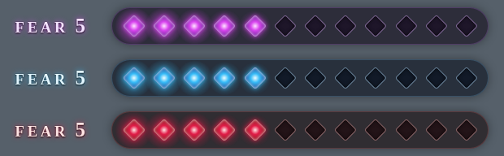
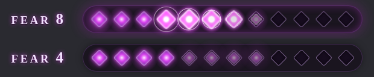
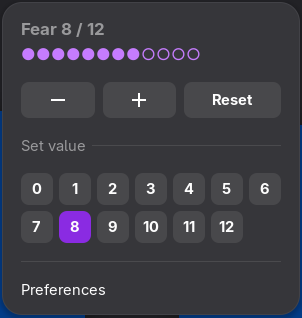

# Fear Tracker

A **Fear** tracker for GMs running [Daggerheart](https://www.daggerheart.com/) over video calls.
You change Fear from the GNOME top bar or with a keyboard shortcut, and your players see it as a
small glowing overlay in your webcam feed, composited by OBS and sent to Zoom (or any other call
app) through the OBS Virtual Camera.



When Fear rises, the new pips ignite one by one and the bar shakes. When it falls, they gutter out:





**Features**

- GNOME Shell extension with a `Fear N` top-bar button. Its menu has −, + and Reset buttons, a
  grid to set an exact value, and preferences.
- Global keyboard shortcuts with an on-screen confirmation. The shortcuts are configurable.
- A configurable maximum (default 12). The value persists across restarts.
- A transparent overlay page built for OBS Browser Sources, with three themes, five sizes,
  alignment options and CSS-only animations.
- A tiny local server (Python standard library only) that is bound to `127.0.0.1`.
- A plain-text fallback (`●●●●●○○○○○○○`) for OBS Text sources.
- A command-line script to set Fear, so you can try everything without GNOME.

<br clear="right">

## How it works

```
GNOME extension ──writes──▶ ~/.config/fear-tracker/fear.json ◀──reads── fear_server.py ──HTTP──▶ overlay.html
                            ~/.config/fear-tracker/fear.txt              (127.0.0.1:8765)        (OBS Browser Source)
                                                                                                         │
                                             Zoom ◀── OBS Virtual Camera (v4l2loopback) ◀── OBS scene ◀──┘
```

The extension writes the state files atomically (temp file plus rename), so readers never see a
partial write. The overlay polls the server a few times per second.

## Requirements

- Linux with **GNOME Shell 51** (Wayland). The overlay, server and CLI work without GNOME.
- **Python 3.10+**. No packages need installing.
- **OBS Studio** with the **Browser Source** plugin, and **v4l2loopback** for the virtual camera.
- Any video-call app that accepts a webcam, such as Zoom, Google Meet, Discord or Teams.

## Installation

### 1. OBS and the virtual camera

**Arch / CachyOS**

```sh
sudo pacman -S --needed obs-studio obs-studio-plugin-browser v4l-utils
```

- On Arch, the Browser Source is a separate package (`obs-studio-plugin-browser`). Without it,
  OBS has no "Browser" source.
- **CachyOS kernels** (`linux-cachyos`, `-bore`, `-lts`, …) include the v4l2loopback module.
  Don't install `v4l2loopback-dkms` on them, because it would shadow the built-in module.
  Check with `modinfo v4l2loopback`.
- **Other Arch kernels** need `v4l2loopback-dkms` plus the matching headers package (for
  example `linux-headers`).

**Other distributions:** install OBS and your distribution's v4l2loopback package, which is
usually a DKMS package, and make sure OBS has the browser source (most distro builds and the
Flatpak `com.obsproject.Studio` include it).

**Load the module persistently.** `exclusive_caps=1` is required; without it, Chromium- and
WebRTC-based apps (Zoom included) won't list the camera.

```sh
echo v4l2loopback | sudo tee /etc/modules-load.d/v4l2loopback.conf
echo 'options v4l2loopback devices=1 video_nr=10 card_label="OBS Virtual Camera" exclusive_caps=1' \
  | sudo tee /etc/modprobe.d/v4l2loopback.conf
sudo modprobe -r v4l2loopback 2>/dev/null; sudo modprobe v4l2loopback
v4l2-ctl --list-devices     # should list "OBS Virtual Camera ... /dev/video10"
```

Without this config, OBS loads the module on demand and asks for your password each time you
start the virtual camera.

### 2. The extension and the server

```sh
git clone https://github.com/Finradon/fear-tracker.git ~/.local/src/fear-tracker
cd ~/.local/src/fear-tracker
make install-service        # extension + overlay server as a systemd user service
# or: make install          # extension only; run the server yourself with `make serve`
```

`scripts/install.sh` (which the make targets call) is idempotent. It:
- compiles the settings schema,
- symlinks the extension into `~/.local/share/gnome-shell/extensions/` (`--copy` copies it instead),
- creates the state file,
- optionally installs and starts `systemd/fear-overlay.service`,
- marks the extension enabled.

Keep the clone where it is, because the extension and the service point into it.

**Log out and back in.** GNOME Shell on Wayland only discovers new extensions at login. Then
check:

```sh
gnome-extensions info fear-tracker@local    # State: ACTIVE
```

### 3. OBS scene

1. **Sources → + → Video Capture Device (V4L2)**: choose your real webcam (not "OBS Virtual
   Camera"), then right-click it and choose **Transform → Fit to screen**.
2. **Sources → + → Browser**:
   - URL: `http://127.0.0.1:8765/overlay.html` (add parameters, see below)
   - Width × height: **800 × 100** for the default size (see the table below)
   - Clear the *Custom CSS* field. The page is already transparent.
3. Keep the browser source **above** the webcam in the source list, and drag it into a corner.
   Use `?align=left` or `?align=right` so the pips hug that edge.
4. Click **Start Virtual Camera**.

### 4. Zoom (or another call app)

Start the OBS virtual camera first. Then open **Settings → Video → Camera**, choose **OBS
Virtual Camera**, and untick **Mirror my video**. Zoom only mirrors your own preview, so
participants always see the overlay the right way round. Unticking it makes your preview match
what they see.

Both the native Zoom client (e.g. the AUR `zoom` package) and Flatpak `us.zoom.Zoom` can access
the virtual camera without extra permissions. The web client works too.

## Usage

| Action | Default shortcut |
|---|---|
| Fear +1 | **Ctrl+Super+Page Up** |
| Fear −1 | **Ctrl+Super+Page Down** |
| Reset to 0 | **Ctrl+Super+Home** |

These shortcuts don't clash with GNOME's defaults, and they work on any keyboard layout.

You can also click the top-bar button to use the menu. **Preferences** (in the menu, or
`gnome-extensions prefs fear-tracker@local`) let you set:
- the maximum Fear (1–30),
- whether the on-screen popup appears,
- the shortcuts: click a row, then press the new combination. Esc cancels and Backspace
  disables the shortcut.

### Without GNOME

`scripts/set_fear.py` writes the same state files, so the overlay works on any desktop:

```sh
make serve                              # run the server in the foreground
python3 scripts/set_fear.py 5           # set Fear to 5
python3 scripts/set_fear.py +1          # relative change (+N / -N)
python3 scripts/set_fear.py 3 --max 8   # change the maximum
python3 scripts/set_fear.py             # print the current state
make demo                               # random walk, to preview the animations
```

To preview the overlay in a normal browser, open `http://127.0.0.1:8765/overlay.html?bg=333`.

## Overlay options

Add these as URL query parameters, e.g.
`http://127.0.0.1:8765/overlay.html?theme=frost&size=sm&align=left`.

| Param | Values | Default |
|---|---|---|
| `theme` | `ember` (purple), `frost` (ice blue), `blood` (crimson) | `ember` |
| `size` | `xs` `sm` `md` `lg` `xl`, or a pip size in px (8–200) | `md` |
| `align` | `left` `center` `right` | `center` |
| `label` | `0` hides the "FEAR 5" label | `1` |
| `count` | `0` hides just the number | `1` |
| `plate` | `0` removes the dark backing plate | `1` |
| `motion` | `0` disables animations (also follows the system's reduced-motion setting) | `1` |
| `poll` | polling interval in ms (100–5000) | `300` |
| `bg` | background colour for browser previews, e.g. `333` (don't use it in OBS) | transparent |

Recommended browser-source sizes for 12 pips with the label shown:

| `size` | Source W × H |
|---|---|
| `xs` | 500 × 60 |
| `sm` | 600 × 80 |
| `md` | 800 × 100 |
| `lg` | 1100 × 130 |
| `xl` | 1400 × 170 |

To shrink the overlay, use a smaller `size` rather than scaling the source down, so it stays
sharp. If the source is too narrow, the pips wrap onto a second row. If the server is
unreachable, the overlay keeps showing the last value.

**Text fallback:** if you can't use the browser source, add a **Text (FreeType 2)** source,
tick *Read from file*, and choose `~/.config/fear-tracker/fear.txt`.

## Configuration

**Server:** `python3 server/fear_server.py [--port N] [--state-dir DIR] [--verbose]`. You can
also set the environment variables `FEAR_PORT` and `FEAR_STATE_DIR`. To change the port of the
systemd service, run `systemctl --user edit fear-overlay` and add:

```ini
[Service]
Environment=FEAR_PORT=9000
```

The server only listens on `127.0.0.1` and serves nothing but the overlay and `/state`.

**State files** live in `$XDG_CONFIG_HOME/fear-tracker/` (normally `~/.config/fear-tracker/`):

- `fear.json`: `{"fear": 5, "max": 12, "updated": <unix ms>}`
- `fear.txt`: `●●●●●○○○○○○○`

Any program can write `fear.json`, as long as it does so atomically. The extension picks up
external changes immediately.

## Troubleshooting

**The extension doesn't appear**
- Run `gnome-extensions info fear-tracker@local`. If it shows `State: ERROR`, check the log with
  `journalctl -f -o cat /usr/bin/gnome-shell`.
- Make sure `gsettings get org.gnome.shell disable-user-extensions` returns `false`.
- "Schema could not be found": run `make schemas`, then log out and back in.
- The extension targets GNOME Shell 51 (`gnome-shell --version`).

**A shortcut does nothing**
- Another app may own that combination. Rebind it in Preferences.

**The overlay doesn't update**
- `curl -s http://127.0.0.1:8765/state` should change when you press a shortcut.
- If it doesn't, check `systemctl --user status fear-overlay`.
- If the state changes but OBS doesn't, open the source properties and click **Refresh cache of
  current page**.
- If there is no "Browser" source in OBS, the browser plugin isn't installed.

**The virtual camera is black or missing**
- Check `lsmod | grep v4l2loopback` and `v4l2-ctl --list-devices`.
- Start the OBS virtual camera *before* selecting it in Zoom. With `exclusive_caps=1`, the
  device only appears once OBS is writing to it.
- Make sure `/sys/module/v4l2loopback/parameters/exclusive_caps` starts with `Y`.

**The video is mirrored:** in Zoom, go to Settings → Video and untick *Mirror my video*.

## Development

```sh
make test     # unit tests for the state format, server and CLI (standard library unittest)
make check    # tests + strict schema compile (+ JS syntax check if node is available)
make pack     # build a zip for `gnome-extensions install`
```

To test the extension without logging out, run it in a nested GNOME Shell. Since GNOME 49 this
needs the `mutter-devkit` package:

```sh
dbus-run-session gnome-shell --devkit --wayland
```

```
extension/fear-tracker@local/   GNOME Shell extension (ESM), prefs, GSettings schema
server/                         fear_server.py (HTTP) and fearstate.py (file format)
overlay/overlay.html            the OBS browser-source page (single file, no build step)
scripts/                        install.sh, uninstall.sh, set_fear.py
systemd/fear-overlay.service    optional user service for the server
tests/                          unit tests
```

## Uninstall

```sh
make uninstall                  # keeps ~/.config/fear-tracker
scripts/uninstall.sh --purge    # also removes the state files
```

If you no longer need the module config, also remove `/etc/modules-load.d/v4l2loopback.conf`
and `/etc/modprobe.d/v4l2loopback.conf`.

## License

MIT, see [LICENSE](LICENSE).

This is an unofficial fan project and is not affiliated with Darrington Press. Daggerheart is a
trademark of Darrington Press.
